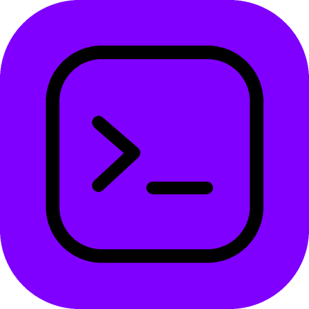
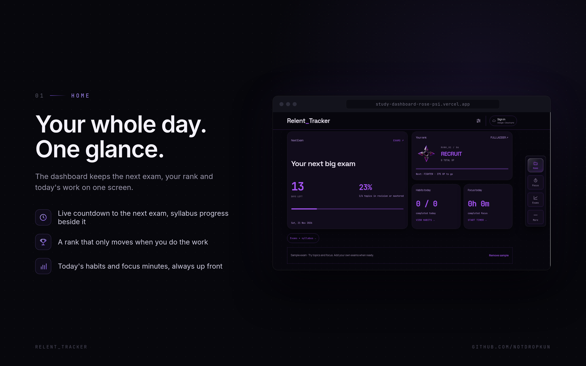
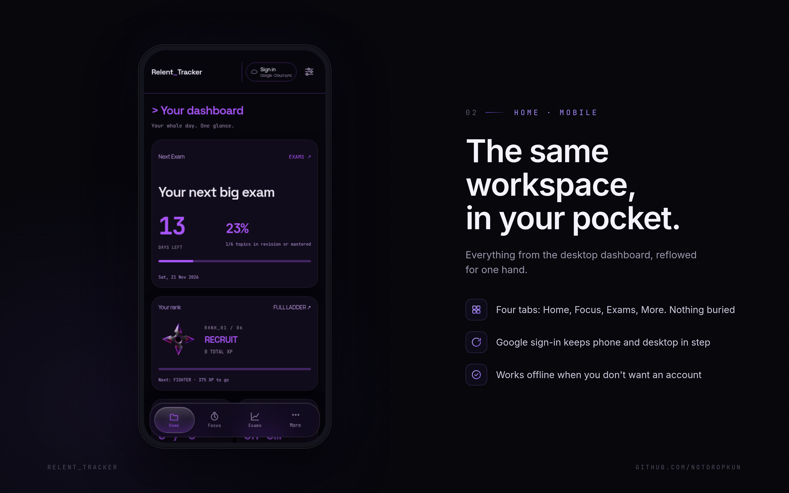
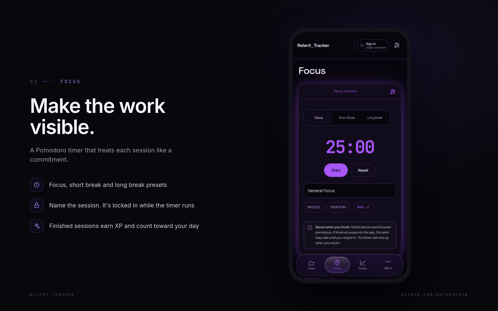
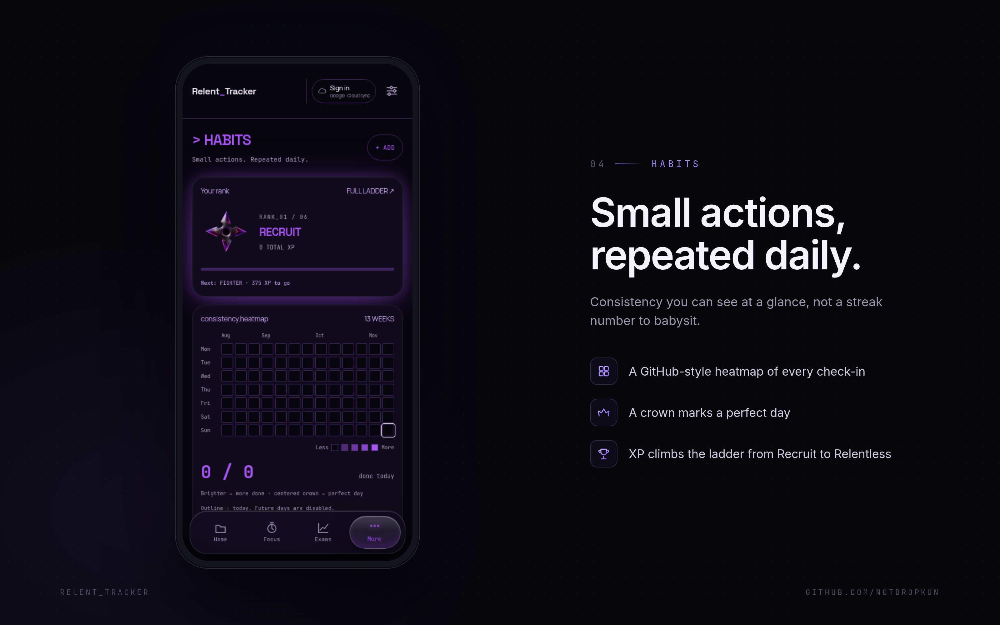
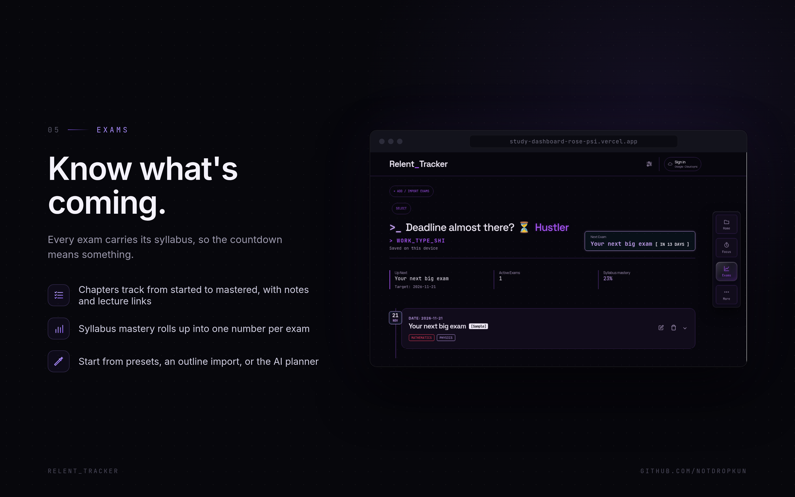
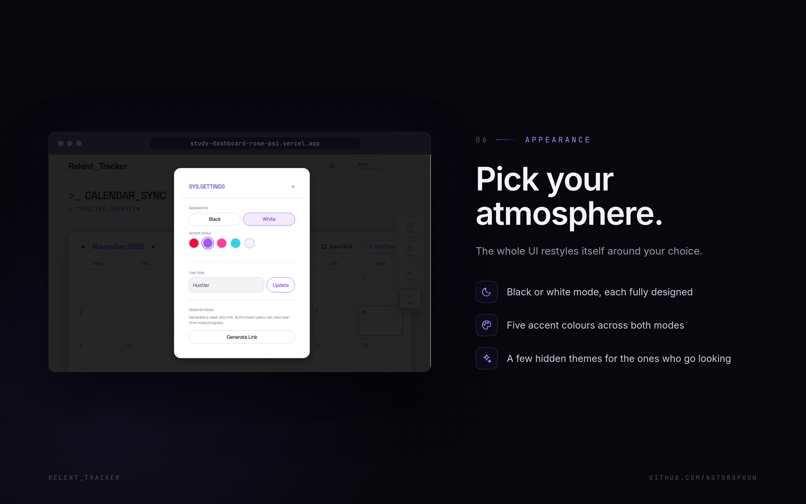

<p align="center">
  
</p>

<h1 align="center">RELENT TRACKER</h1>

<h3 align="center">Your exams. Your habits. Your next move.</h3>

<p align="center">
  A study workspace built by a student, for the days when everything is due at once.<br>
  <strong>Plan the syllabus. Put in the focus sessions. Watch the rank climb.</strong>
</p>

<p align="center">
  <a href="https://study-dashboard-rose-psi.vercel.app">Open the dashboard</a> ·
  <a href="https://github.com/notdropkun/Relent-Tracker/releases">Get the Android app</a> ·
  <a href="https://github.com/notdropkun/Relent-Tracker/releases/tag/v1.3.1">See what's new</a>
</p>

<p align="center">
  
  
  
  
</p>

<p align="center">
  
</p>

<p align="center"><strong>Exam countdowns · Habits + XP ranks · Focus timer · Squad · Android widgets</strong></p>

---

## ⚡ Built around studying, not just checking boxes

Relent Tracker started as my own study dashboard. I'm a Class 12 student building it around board prep and entrance-exam revision, then making it useful for other students too.

The idea is simple: keep the exam, its syllabus, today's habits and your focus time in the same place. The web app and Android app share the same workspace, with Google sign-in for sync or an offline mode when you don't want an account.

[Features](#-one-workspace-from-plan-to-progress) · [Screenshots](#-inside-the-app) · [Android](#-take-it-to-your-home-screen) · [Data](#-your-data-without-the-small-print) · [Source](#-under-the-hood)

## ✨ One workspace, from plan to progress

### 📚 Know what's coming

- Add exams with dates and a live countdown.
- Break the syllabus into subjects, categories and topics.
- Each chapter is a card: track its state from not started to covered, keep notes and your starred lecture links with watched progress.
- Start fast with premade subject presets, import an outline, or let the AI planner turn pasted syllabus text into a structured plan.
- Pull your Google Calendar events into the same timeline.

### ✅ Small actions, repeated daily

- Build habits and check in every day.
- Watch the consistency heatmap fill in; a crown marks a perfect day.
- Earn XP from habits and completed focus sessions and climb the rank ladder, from Recruit to Relentless, with its own badge artwork.
- The rules are in the app under "Learn your rank" - no hidden math.

### ⏱️ Make the work visible

- Run Pomodoro focus sessions with short and long breaks.
- Name what you're focusing on - it's locked in while the timer runs, so the session means something.
- Finished sessions earn XP and count toward your day and your Squad standing.

### 🏆 Squad up, privately

- Add friends with a code and compare today's completed focus minutes on a daily leaderboard.
- You choose who joins. The Squad record a friend sees contains your display name, your daily focus minutes and whether a timer is running.
- The board is today only; it resets every day. Your XP rank is separate and keeps climbing.

### 🎨 Pick your atmosphere

Black or white mode, five accent colours, and a dock that floats over it all. Plus a few hidden themes for the ones who go looking.

The dashboard's terminal-style details, line icons and Android widget themes make it feel like your own workspace.

## 📸 Inside the app

Real captures from the web app. No invented screens.

<p align="center">
  
</p>
<p align="center">
  
</p>
<p align="center">
  
</p>
<p align="center">
  
</p>
<p align="center">
  
</p>

## 📱 Take it to your home screen

The Android app, **RTracker**, wraps the web dashboard in a native Kotlin shell and adds home-screen widgets and an in-app update check.

| Widget | What it puts in reach |
| --- | --- |
| Exam | Your next exam, with syllabus details in the larger layout |
| Calendar | A month view with exam and event markers |
| Focus | A 15-week activity grid, theme sync and a shortcut into Focus |
| Habits | Your rank and pinned habits; stretch it for the full daily checklist and tap to check in |

Log in once in the app to connect your widgets to your account. Use the same Google account on the web and Android for your synced workspace.

### Download and install

1. Open [GitHub Releases](https://github.com/notdropkun/Relent-Tracker/releases).
2. Download the `RTracker` APK from the release you want.
3. Open the file on Android and allow installation from that source if Android asks.

**Current featured release:** v1.3.1, with auto-refreshing widgets.

**A note on updating from v1.3.0 or older:** v1.3.1 is signed with a new key, so Android won't offer it as an update over those versions. Don't uninstall before you're ready - a fresh install removes local app and widget data.

**Android 7.0 or newer** (verified from the published APK). Keep Android System WebView updated.

### Updates, without starting over

Use **Settings → Android App → Check for updates** inside RTracker. The in-app updater checks GitHub releases. Website features are deployed separately, so not every web change needs a new APK.

**Install new APKs over the existing app as long as they're signed with the same key.** If Android refuses an update install, stop there - the signing keys differ, and uninstalling removes local app and widget data. Check the release notes before going further.

Prefer an external update manager? Add `https://github.com/notdropkun/Relent-Tracker` in [Obtainium](https://github.com/ImranR98/Obtainium).

<details>
<summary>🔏 Verify an APK</summary>

<br>

The v1.3.1 APK's SHA-256 hash is:

```text
8c16ec344094e0cec51e7970972e37d89105cbf7bfe082e9da45a06607303b0d
```

The v1.3.1 signing certificate SHA-256 fingerprint is:

```text
D2:5A:81:C7:D7:53:C3:39:98:0F:7E:DF:F4:CE:BB:67:0E:7F:D2:1F:AD:74:32:B2:7B:E5:C5:BB:89:B0:89:B9
```

Both verified against the published v1.3.1 APK itself. Releases up to v1.3.0 were signed with a different certificate (`CF:00:EA:AB…`), since replaced - which is why they can't update in place to v1.3.1.

</details>

## 🌐 Or just open the website

[Launch Relent Tracker](https://study-dashboard-rose-psi.vercel.app).

The web app includes a PWA manifest and service worker for installation. Online features such as sign-in, cloud sync and fetching updates still need a connection.

## 🔐 Your data, without the small print

- **Offline mode:** your workspace is stored on your device. Clearing site/app storage or uninstalling can remove local data.
- **Google sign-in:** Firebase Authentication handles login; Firestore stores synced study data for use across devices.
- **Observer links:** let someone view a read-only snapshot. Share one only with people you want to see that information.
- **Squad and friends:** off until you opt in. What gets shared is your display name, your daily focus minutes and your timer status.
- **Widgets:** exam details are mirrored into a separate Firestore widget record. Don't treat the widget mirror as a place for confidential information.

This isn't an account-free, cloud-free app when you choose sync. Offline mode and cloud sync are different choices.

## 🛠️ Under the hood

| Layer | Built with |
| --- | --- |
| Web interface | HTML, CSS and JavaScript |
| Sign-in and sync | Firebase Authentication and Firestore |
| AI syllabus import | Vercel serverless function (bring-your-own provider key via env vars) |
| Installable web app | Web app manifest and service worker |
| Hosting | Vercel |
| Android shell and widgets | Kotlin / Android |
| APK distribution and update source | GitHub Releases |

This repository contains the **website source and Android release downloads**. The native Android source isn't in this repository at present.

```text
Relent-Tracker/
├── index.html        # Dashboard, styles and app logic
├── manifest.json     # PWA configuration
├── sw.js             # Service worker
├── api/              # Serverless functions (AI syllabus import)
├── assets/           # Audio, icons and other app assets
├── docs/screenshots/ # README hero, logo and promo captures
├── .well-known/      # App/site association files
├── SECURITY.md
└── LICENSE
```

The web project has no bundled frontend build step. To explore a local copy, serve the repository with a local HTTP server. Cloud sign-in and sync need your own Firebase setup and authorized domains; a fork isn't automatically a separate backend.

## 🧑‍💻 Built between study sessions

I'm Advaay. Relent Tracker is the workspace I wanted while studying, and an excuse to keep learning by shipping things I actually use.

It's still growing. Found a bug? Describe what happened, what you expected and whether you were on the website or Android app. Remove private study data and account details from screenshots before posting.

## 📄 License

[MIT](LICENSE). Keep the copyright and license notice when reusing the code.

---

<p align="center">
  
</p>

<p align="center"><strong>Less juggling. More studying.</strong></p>

<p align="center">
  <a href="https://study-dashboard-rose-psi.vercel.app">Open the dashboard</a> ·
  <a href="https://github.com/notdropkun/Relent-Tracker/releases">Download RTracker</a>
</p>

<p align="center">Built by Advaay. Still studying. Still shipping.</p>
